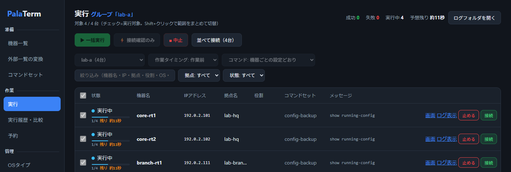
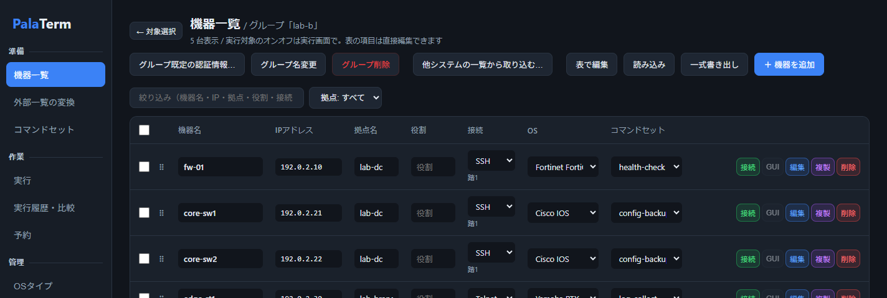

# PalaTerm

**Parallel SSH / Telnet / Serial Access — batch login tool for network engineers.**

English version: [README.md](README.md)

複数のネットワーク機器（Cisco IOS/ASA・JUNOS・FortiGate・HPE・NEC IX・Yamaha RTX など）に SSH / Telnet / シリアルで一括ログインし、
ログ取得・コマンド一括実行・設定変更を並列で行うWindows用ツールです。Tera Term マクロや手作業のログ採取の置き換えを想定しています。
単一のポータブルexeで動作し、インストール不要です。紹介ページ: https://kojio145.github.io/palaterm/

> **開発状況: v1.7.12（β）。** 動作しますが荒削りな部分があります。Issueでのフィードバック歓迎です。

## 特徴

- 🖥 **同時ログイン**: 機器リストの全機器へ並列接続（同時実行数は調整可能）
- 📡 **3つの接続方式**: SSH / Telnet / シリアルコンソール（COMポート自動探索）
- 🏢 **踏み台対応**: 踏み台サーバ経由の多段接続（SSH公開鍵認証対応: Ed25519/RSA/ECDSA・古い踏み台向けの旧形式DSA・パスフレーズ付き鍵可。OpenSSH の ProxyJump と同じ「SSH トンネル」で、2 段目以降もこの PC の鍵でログイン可。自分の踏み台（最大5段・自分の鍵）は機器リストと別に持ち、機器は「自分の踏み台を通る」だけを持つので、グループの機器一式を鍵抜きで同僚に渡せる。現場では実行・窓ごとに踏み台なしで直接接続も可）
- 🌐 **GUI に自動ログイン**: FortiGate などの管理画面を PalaTerm の窓で開き、機器のユーザー名・パスワードで自動ログイン（http / https・ポート指定可）。自己署名の証明書は警告を押して進む代わりに初回の証明書を記録して照合。GUI だけの機器も登録可
- 📊 **表で編集**: Excel のように表の上で複数の機器をまとめて編集（Excel とのコピー・貼り付け、Ctrl+D、連番、元に戻す、検索・置換）。保存までは暗号化した下書きで、エラーの行だけ下書きに残してほかを保存することも可
- 🤖 **ログイン自動化**: Cisco IOS/ASA・JUNOS・FortiGate・HPE・NEC IX・ALAXALA AX・Yamaha RTX・Linuxサーバなど17種のOSプロファイル内蔵。enable昇格・ページャ無効化まで自動。全プロファイル編集可・自作追加可
- 📋 **コマンド一括実行**: 名前付きコマンドセットを機器ごとに割当てて一括実行
- 📁 **ログ自動保存**: `{host}_{site}_{role}_{stage}_{date}_{time}.txt` 形式（プレースホルダでカスタム可）
- 🕘 **実行履歴と作業前後の比較**: 作業前／作業中／作業後を選んで実行し、同じ機器の作業前・作業後のログを差分表示（時刻・カウンタの違いは無視）
- ⏰ **予約**: 決まった日時（1回・毎日・毎週・一定間隔（秒〜））に一括実行してログを取得（show 系の取得専用）。トレイ常駐・ロック中も実行・スリープ解除タイマー対応
- ⚠️ **設定変更コマンドの事前警告**: `conf t` / `write` / `reload` などを含むセットは実行前に警告。接続確認だけのドライランも可
- 🏢 **グループ既定の認証情報**: 会社ごとの共通アカウントを一度だけ登録、機器ごとに個別設定も可
- 🔒 **認証情報の暗号化保存**: マスターパスワードによるAES-256-GCM暗号化（平文保存なし）
- 💻 **対話接続**: 1台にログイン自動化まで済ませてから手動操作に引き継ぐ内蔵ターミナル（xterm.js）。自動ログインなしの接続（Shift+クリック／接続中の「手動に切り替え」）もあり、シリアルでの初期キッティングにも使える
- 🌐 **日本語 / 英語 UI**
- 🚫 **外部通信ゼロ**: テレメトリなし・自動更新なし。社内ネットワークでの利用を想定した設計

## 動作環境

- Windows 10 / 11（x64）。WebView2 ランタイムを使用します（現行の Windows 10/11 には入っていますが、Windows 10 LTSC・Windows Server・オフラインイメージには入っていないことがあります。その PC では先に Microsoft の「WebView2 Evergreen Standalone Installer」（オフライン版）を入れてください）。
- USB シリアル変換ケーブルは、先にメーカーのドライバを入れて COM ポートがデバイスマネージャーに出ている必要があります（PalaTerm は Windows が認識しているポートだけを一覧に出します）。
- マスターパスワードを忘れると vault は復元できません。

## インストール

不要です。[Releases](../../releases) から `PalaTerm-vX.Y-win64.zip` をダウンロードして展開し、できた `PalaTerm` フォルダごと好きな場所（例: `C:\Tools\PalaTerm`）に置いて、中の `PalaTerm.exe` を実行してください。vault・ログ・書き出しはそのフォルダの中に作られるので、exe の周りが散らかりません。更新用に `PalaTerm.exe` 単体も添付しています（フォルダはそのまま、exe だけ差し替え）。
PalaTerm のデータ（暗号化vault・ログ・書き出しファイル）はすべて exe の隣に作られます。
例外は 2 つで、どちらにも PalaTerm のデータは含まれません。WebView2 ランタイム自身のブラウザキャッシュ（Windows が
`%APPDATA%\PalaTerm.exe\EBWebView\` に作ります）と、GUI の窓ごとの一時的な WebView2 プロファイル
（`%LOCALAPPDATA%\PalaTerm\GUI\w-<pid>-<ns>`。窓を閉じると消えます。強制終了で残った分は、次回の PalaTerm 起動時または GUI の窓を閉じたときに片付けられます）です。
アンインストールは exe のフォルダを削除するだけです（必要ならこの 2 つのフォルダも削除してください）。

無署名exeのため、初回実行時にMicrosoft Defender SmartScreenの警告が出ることがあります
（「詳細情報」→「実行」で起動できます）。コード署名は導入予定です。

## はじめかた

1. [Releases](../../releases) から `PalaTerm-vX.Y-win64.zip` をダウンロードして展開します。
2. 展開した `PalaTerm` フォルダの中の `PalaTerm.exe` を起動します。
3. 初回はマスターパスワードを決めて「作成して開始」を押します。忘れると復元できません。すべてのデータは exe の隣の `data\palaterm_vault.enc`（暗号化データ。vault）に暗号化して保存されます。新しい vault には「サンプル」グループとサンプルのコマンドセットが入っています（見て消しても構いません）。exe を移動したときは、新しい vault を作らず、以前の `data\palaterm_vault.enc` を隣にコピーしてください。
4. 「機器一覧」タブで「＋ 新規グループ作成」を押し、名前を付けます（例: `lab`）。
5. 「＋ 機器を追加」を押し、機器名・IPアドレス / ホスト名・接続方式（SSH / Telnet / シリアル）・OSタイプ・認証情報を入れます。踏み台は任意です（「＋ 踏み台を追加」）。Ctrl+Enter で保存できます。
6. 「コマンドセット」タブで「＋ セットを追加」を押し、1 行 1 コマンドで入力します（例: `show version`）。そのセットを機器に割り当てます（機器の編集画面か一覧のセル、台数が多ければ「表で編集」）。
7. 「実行」タブでグループを選び、機器にチェックを入れて「▶ 一括実行」を押します（「⚡ 接続確認のみ」はコマンドを送らずログインだけ確かめます。確認なしですぐ始まります）。
8. 機器ごとの結果は「状態」「メッセージ」列に出ます。「ログ表示」は書き込み中のログをそのまま開き、失敗した行の「編集」で機器を直してから「↻ 失敗のみ再実行」できます。
9. ログは exe の隣の `logs\` に実行ごとのフォルダで保存されます（「ログフォルダを開く」で開けます）。「実行履歴」タブで過去の実行を一覧し、作業前・作業後のログを比較できます。

機器をまとめて登録するには、機器一覧の「読み込み」で CSV を読み込みます（先にファイルを選び、次に所属グループを決めます）。「一式書き出し」でグループまたは全機器を丸ごと書き出せます。現在の列構成の見本が [examples/devices.sample.csv](examples/devices.sample.csv) にあります（ラボ用の架空値）。

## ドキュメント

- [利用マニュアル](docs/manual.html)
- [使い方ガイド](docs/USAGE.md) / [ビルド手順](docs/BUILD.md)
- [セキュリティレビュー記録](docs/SECURITY.md) — 脆弱性の報告方法は [SECURITY.md](SECURITY.md) を参照
- [開発記（Zenn）](https://zenn.dev/kjo145/articles/palaterm-batch-login-go-wails) — 設計方針・作業前後の照合・実機検証で踏んだバグ・配布の壁

## サポート方針

個人が余暇で開発しているツールです。Issue・機能要望は読みますが、対応は不定期です。
即日の回答は期待しないでください。

## ライセンス

MIT License. 商用利用可。詳細は [LICENSE](LICENSE) を参照してください。
同梱サードパーティライセンス: [THIRD-PARTY-NOTICES.md](THIRD-PARTY-NOTICES.md)

**免責**: 本ツールはネットワーク機器への接続・設定変更を自動化します。
利用によって生じたいかなる損害についても作者は責任を負いません。
本番機器への利用は、必ず検証環境での動作確認と所属組織のルール確認のうえで行ってください。
