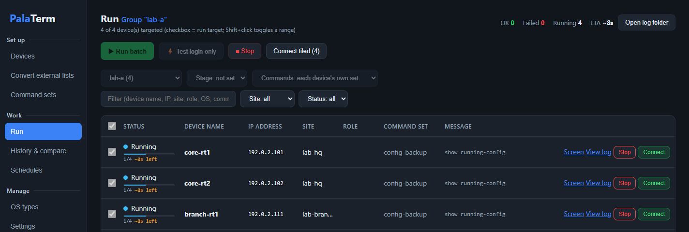
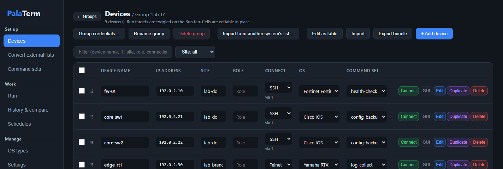

# PalaTerm

**Parallel SSH / Telnet / Serial access — batch login tool for network engineers.**

日本語版は [README.ja.md](README.ja.md) を参照してください。

PalaTerm logs in to many network devices at once to collect logs, run command sets,
and apply configuration changes in parallel. It ships as a single portable
Windows exe — no installation required.

> **Status: v1.7.12 (beta).** It works, but expect rough edges. Feedback via Issues is welcome.

> 日本語の概要: 複数のネットワーク機器（Cisco IOS/ASA・JUNOS・FortiGate・HPE・NEC IX・Yamaha RTX など）に SSH / Telnet / シリアルで一括ログインし、
> コマンドセットを並列実行してログを自動保存する Windows 用ツールです。Tera Term マクロや手作業のログ取得の置き換えを想定しています。
> 紹介ページ: https://kojio145.github.io/palaterm/

## Features

- 🖥 **Parallel login** — connect to every device in your list at once (concurrency is adjustable)
- 📡 **Three transports** — SSH / Telnet / serial console (COM ports auto-discovered)
- 🏢 **Jump host support** — multi-hop connections through bastion servers
  (SSH public-key auth: Ed25519/RSA/ECDSA plus legacy PEM DSA for old jump servers, passphrase-protected keys supported;
  an SSH tunnel mode, like OpenSSH's ProxyJump, logs into every hop from your PC with its own key;
  your own jump hosts (up to 5 hops, with your key) are kept apart from the device list — a device only says "go through my jump host",
  so a group's devices can be handed to a colleague without your key;
  a run or a window can skip the jump hosts when you are on site)
- 🌐 **Web GUI login** — open a device's management page (FortiGate & co.) in a PalaTerm window, logged in with its credentials
  (http or https, any port); self-signed certificates are pinned on first use instead of clicked through. GUI-only devices are supported too
- 📊 **Edit as table** — edit many devices at once like a spreadsheet: copy and paste with Excel, Ctrl+D, fill series, undo, find and replace;
  changes stay an encrypted draft until saved, and rows with errors can be kept back while the rest are saved
- 🤖 **Login automation** — 17 built-in OS profiles (Cisco IOS/ASA, JUNOS, FortiGate,
  HPE, NEC IX, ALAXALA AX, Yamaha RTX, Linux servers, …) handling enable escalation and pager disabling; all
  profiles are editable and you can add your own
- 📋 **Batch command execution** — assign named command sets per device and run them in one go
- 📁 **Automatic log saving** — `{host}_{site}_{role}_{stage}_{date}_{time}.txt` style, customizable with placeholders
- 🕘 **Run history & before/after diff** — tag a run as before / during / after the work, then compare
  the before and after logs per device (clock and counter noise ignored)
- ⏰ **Schedules** — run a batch at set times (once / daily / weekly / every n seconds–hours, optionally n times) for collecting show output;
  keeps running from the tray and while locked, wakes the PC from sleep where Windows allows it
- ⚠️ **Warning before configuration changes** — a command set that contains `conf t` / `write` / `reload` … is called out
  before the batch starts; "Connect check only" logs in to every device without sending a command, to check credentials and reachability
- 🏢 **Group default credentials** — one shared account per group, with per-device overrides
- 🔒 **Encrypted credential vault** — AES-256-GCM protected by a master password (nothing stored in plain text)
- 💻 **Interactive terminal** — automate the login to a single device, then take over
  manually in a built-in terminal (xterm.js); or skip the automatic login (Shift+click, or
  "Switch to manual" while connecting) for initial setup over a serial console
- 🌐 **English / Japanese UI**
- 🚫 **Zero external communication** — no telemetry, no auto-update; designed for use inside closed networks

## Requirements

- Windows 10 / 11 (x64). Uses the WebView2 runtime, which is included in current Windows 10/11 but missing on
  Windows 10 LTSC, Windows Server and offline images; on such PCs install Microsoft's "WebView2 Evergreen Standalone Installer" (offline) first.
- USB-serial adapters need the vendor's driver installed first (the COM port must show up in Device Manager); PalaTerm lists only ports Windows already knows.

If you forget the master password the vault cannot be recovered.

## Installation

None needed. Download `PalaTerm-vX.Y-win64.zip` from [Releases](../../releases), extract it, and put the `PalaTerm` folder wherever you like (e.g. `C:\Tools\PalaTerm`). Run `PalaTerm.exe` inside it — the vault, logs and exports are created in that folder, so nothing is scattered around the exe. The bare `PalaTerm.exe` is also attached for updating in place: replace the exe, keep the folder.
All PalaTerm data (encrypted vault, logs, exports) is written next to the exe.
There are two exceptions, neither of which holds PalaTerm data: the WebView2 runtime's own browser cache, which Windows keeps
under `%APPDATA%\PalaTerm.exe\EBWebView\`, and the GUI window's temporary WebView2 profile, one per window under
`%LOCALAPPDATA%\PalaTerm\GUI\w-<pid>-<ns>`, which is deleted when the window closes (left behind after a forced kill,
cleaned up the next time PalaTerm starts or a GUI window closes).
To uninstall, delete the exe folder and, optionally, those two folders.

Unsigned executables may trigger a Microsoft Defender SmartScreen warning on first
launch ("More info" → "Run anyway"). Code signing is planned.

## Quick start

1. Download `PalaTerm-vX.Y-win64.zip` from [Releases](../../releases) and extract it.
2. Run `PalaTerm.exe` inside the extracted `PalaTerm` folder.
3. On first launch, set a master password and press "Create & start". It cannot be recovered if forgotten; everything is stored encrypted in `data\palaterm_vault.enc` next to the exe. A new vault comes with a "Sample group" and sample command sets ("[Sample] Cisco router" etc.) to look at or delete. If you moved the exe, copy your old `data\palaterm_vault.enc` next to it instead of creating a new vault.
4. In the Devices tab, press "+ New group" and name it (e.g. `lab`).
5. Press "+ Add device" and fill in the device name, address (IP or DNS name), connection (SSH / Telnet / serial), OS type and credentials. A jump host is optional ("+ Add jump host"). Ctrl+Enter saves.
6. In the Command sets tab, press "+ Add set" and enter one command per line (e.g. `show version`); then assign the set to the device (device edit screen, the table cell, or "Edit as table" for many devices).
7. In the Run tab, select the group, tick the devices and press "▶ Run batch" ("⚡ Connect check only" logs in without sending anything and starts without a confirmation).
8. Read the result per device in the Status / Message columns; "View log" opens the log as it is written, and a failed row's "Edit" opens the device for a fix before "Re-run failed only".
9. Logs are saved under `logs\` next to the exe (one folder per run; "Open log folder" opens it); the History tab lists past runs and compares before / after logs.

Many devices at once: import a CSV in the Devices tab ("Import"; the file is chosen first, then the target group), or export everything with "Export bundle". [examples/devices.sample.csv](examples/devices.sample.csv) has the current column set with lab values.

## Documentation

- [User manual](https://kojio145.github.io/palaterm/manual.html) (Japanese)
- [Usage guide](docs/USAGE.md) (Japanese) / [Build instructions](docs/BUILD.md)
- [Security review record](docs/SECURITY.md) — see [SECURITY.md](SECURITY.md) for how to report vulnerabilities
- [Development story on Zenn](https://zenn.dev/kjo145/articles/palaterm-batch-login-go-wails) (Japanese) — design, before/after verification, bugs found on real devices, distribution hurdles

## Support

This is a spare-time project. Issues and feature requests are read, but responses
and fixes happen on an irregular schedule — please don't expect same-day answers.

## License

MIT License — commercial use permitted. See [LICENSE](LICENSE).
Bundled third-party licenses: [THIRD-PARTY-NOTICES.md](THIRD-PARTY-NOTICES.md).

**Disclaimer**: This tool automates connections to and configuration changes on
network equipment. The author accepts no liability for any damage arising from its
use. Before using it against production devices, test in a lab environment and
confirm your organization's rules.
